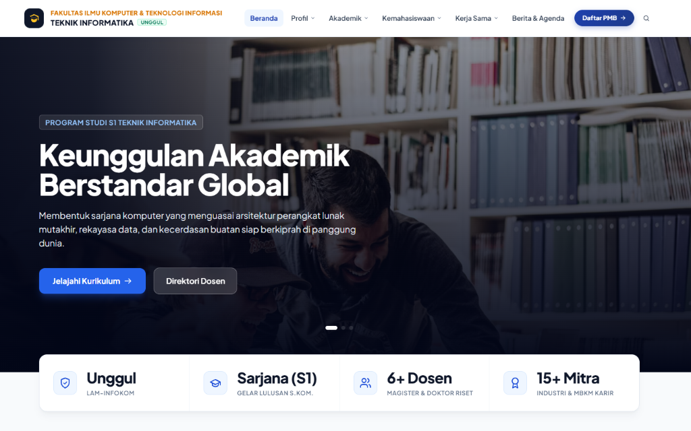
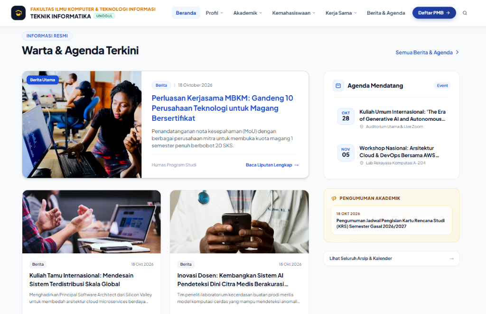
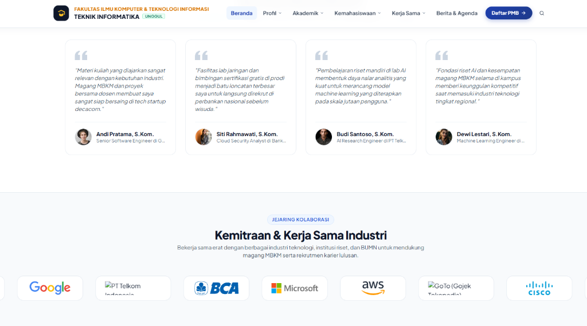
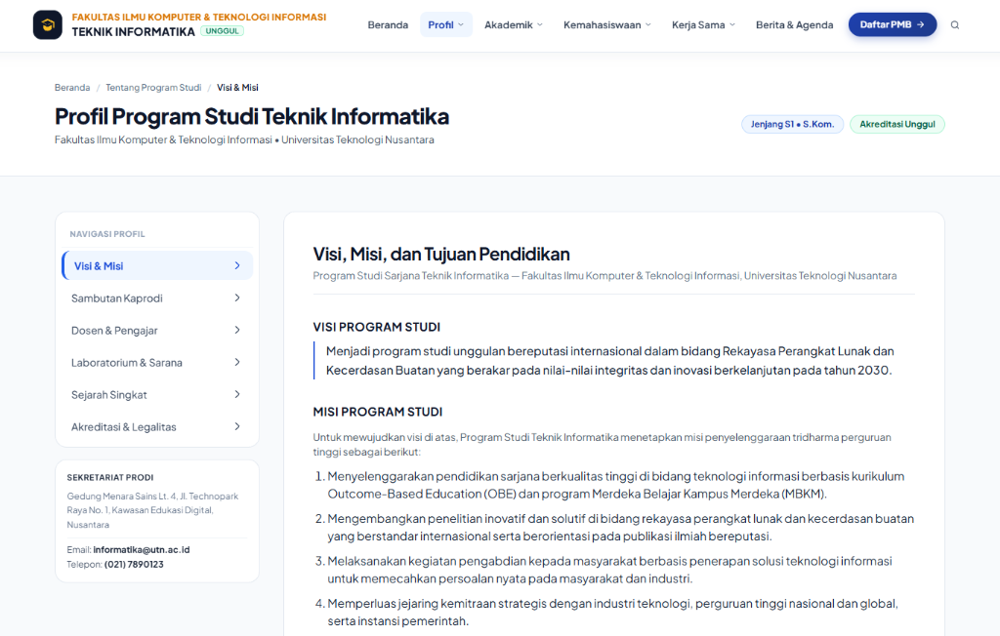

# Template-Prodi-CMS 🎓

> **Modern, White-Label University Department (Program Studi) CMS & Portal**  
> Dibangun dengan **Python 3.10+**, **Django 5.x**, **Django Unfold (Modern Admin Dashboard)**, dan **Tailwind CSS**.

[](https://www.python.org/)
[](https://www.djangoproject.com/)
[](https://tailwindcss.com/)
[](https://github.com/unfoldadmin/django-unfold)
[](LICENSE)

Template CMS Website Program Studi ini dirancang khusus dengan filosofi **White-Label & Reusable Starter**. Program studi apa pun (*Teknik Informatika, Sistem Informasi, Manajemen, Akuntansi, Teknik Elektro, dsb.*) dapat mengkloning template ini dan menggunakannya secara langsung tanpa perlu merombak ulang kode sumber. Seluruh identitas prodi, akreditasi, kurikulum, dosen, dan berita dapat dikelola mandiri dari panel admin.

---

## 📸 Preview Antarmuka

### 1. Beranda & Hero Section
Tampilan beranda modern dengan banner hero slider institusional, indikator akreditasi, pilar capaian, dan aksi cepat pendaftaran PMB.


### 2. Warta & Agenda Civitas Akademika
Portal publikasi berita, siaran pengumuman akademik, dan agenda acara mendatang yang terorganisir rapi.


### 3. Testimoni Alumni & Jejaring Kemitraan Industri
Menampilkan kiprah lulusan, rekam jejak tracer study, dan portofolio mitra industri/kampus bereputasi.


### 4. Arsitektur Subhalaman 2-Kolom Terpadu
Seluruh subhalaman menggunakan tata letak 2-kolom terpadu (*Left Sticky Sidebar Navigation + Right Editorial Content Pane*) yang saling terhubung dan bebas dari AI-slop.


---

## ✨ Fitur Utama

### 🏛️ 1. Antarmuka Publik (Public Portal)
* **Arsitektur 2-Kolom Terpadu**: Navigasi sidebar kiri yang lengket (*sticky*) dan panel konten editorial kanan yang konsisten di semua subhalaman:
  * **Profil Prodi** (`/profil/`): Visi & Misi, Sambutan Kaprodi, Pimpinan Prodi, Fasilitas Lab, Sejarah, dan Akreditasi.
  * **Direktori Dosen & Peneliti** (`/dosen/`): Filter jabatan fungsional, pencarian instan (nama/NIDN/bidang riset), profil pimpinan struktural, dan tautan repositori akademik (SINTA, Google Scholar, Scopus, LinkedIn).
  * **Peta Kurikulum & Silabus** (`/kurikulum/`): Struktur distribusi 144 SKS, tabulasi semester 1 s.d. 8, rincian beban teori/praktikum, sifat wajib/pilihan, Capaian Pembelajaran Lulusan (CPL OBE), serta unduh berkas RPS.
  * **Pusat Unduhan Dokumen** (`/dokumen/`): Repositori formulir KP/magang, panduan skripsi, borang akreditasi, dan surat ketetapan dengan counter unduhan otomatis.
  * **Kemahasiswaan & Prestasi** (`/kemahasiswaan/`): Rekam jejak prestasi (Internasional, Nasional, Provinsi), profil organisasi HMTI & klub riset, dan testimoni alumni.
  * **Kerja Sama & Kemitraan** (`/kerjasama/`): Portofolio mitra industri terikat MoU, 4 skema implementasi MBKM (magang bersertifikat, dosen tamu, sertifikasi global), dan prosedur inisiasi kemitraan baru.
  * **Kontak & Layanan** (`/kontak/`): Informasi sekretariat resmi, jam layanan loket akademik, peta lokasi, dan FAQ interaktif.
  * **Warta & Informasi** (`/berita/`): Artikel berita, pengumuman akademik, dan agenda dengan pencarian serta hitung pembaca (*views counter*).

### ⚙️ 2. Panel Admin Modern (Django Unfold)
* **Manajemen Identitas Terpusat**: Ubah nama prodi, fakultas, universitas, akreditasi, visi/misi, alamat, kontak, dan tautan PMB langsung dari admin tanpa edit kode.
* **Tampilan SaaS Kontemporer**: Dibangun di atas Django Unfold yang bersih, responsif, dan mudah digunakan staf non-teknis.
* **Perlindungan Data**: Integrasi otentikasi bawaan Django dengan enkripsi sandi terstandar.

---

## 🚀 Panduan Instalasi & Menjalankan Proyek

### Prasyarat
* **Python 3.10** atau versi lebih baru
* **Git**

### Langkah-langkah:

1. **Clone Repositori**:
   ```bash
   git clone https://github.com/Theseadev/Template-Prodi-CMS.git
   cd Template-Prodi-CMS
   ```

2. **Buat & Aktifkan Virtual Environment**:
   * **Windows (PowerShell)**:
     ```powershell
     python -m venv venv
     .\venv\Scripts\Activate.ps1
     ```
   * **Linux / macOS**:
     ```bash
     python3 -m venv venv
     source venv/bin/activate
     ```

3. **Install Dependensi**:
   ```bash
   pip install -r requirements.txt
   ```

4. **Jalankan Migrasi Database**:
   ```bash
   python manage.py migrate
   ```

5. **Isi Data Contoh Awal (Seeding Data)**:
   ```bash
   python manage.py seed_prodi
   ```
   > 💡 **Catatan**: Perintah `seed_prodi` akan menginisialisasi database dengan data profil prodi realistis, dosen, kurikulum semester 1–8, fasilitas lab, mitra, dan otomatis membuat akun superuser admin.

6. **Jalankan Server Pembangunan**:
   ```bash
   python manage.py runserver
   ```
   Buka peramban di: **`http://localhost:8000/`**

---

## 🔐 Kredensial Default Panel Admin

Setelah menjalankan perintah `python manage.py seed_prodi`, Anda dapat langsung masuk ke dashboard admin:

* **URL Panel Admin**: `http://localhost:8000/admin/`
* **Username**: `admin`
* **Password**: `admin123`

*(Disarankan segera mengganti kata sandi setelah melakukan deployment produksi).*

---

## 📁 Struktur Direktori

```text
Template-Prodi-CMS/
├── config/                  # Pengaturan inti Django (settings, urls, wsgi)
├── portal/                  # Aplikasi utama portal program studi
│   ├── management/commands/ # Script data seeding (seed_prodi.py)
│   ├── migrations/          # Migrasi skema database
│   ├── models.py            # Model data prodi, dosen, kurikulum, berita, dll.
│   ├── views.py             # Logika tampilan & query data
│   ├── urls.py              # Routing URL portal
│   ├── admin.py             # Konfigurasi antarmuka Django Unfold
│   └── context_processors.py# Konteks identitas prodi global
├── templates/               # Berkas template antarmuka publik
│   ├── base.html            # Template master, navbar responsif & footer
│   └── portal/              # Template per subhalaman (home, profil, dosen, dll.)
├── static/                  # Berkas statis (CSS, JS, logo)
├── media/                   # Direktori berkas unggahan pengguna
├── docs/                    # Dokumentasi & aset gambar pratinjau
├── requirements.txt         # Daftar pustaka Python yang dibutuhkan
├── .gitignore               # Konfigurasi pengabaian berkas Git
└── manage.py                # Utilitas CLI Django
```

---

## 🛠️ Penyesuaian untuk Program Studi Lain

Untuk menerapkan template ini pada program studi Anda:
1. Masuk ke **Panel Admin** (`/admin/`).
2. Masuk ke menu **Identitas Prodi**.
3. Sesuaikan nama program studi, jenjang studi (S1/D4/D3), fakultas, universitas, status akreditasi, logo resmi, dan informasi kontak.
4. Perubahan akan langsung tercermin secara dinamis di seluruh halaman website tanpa mengubah kode HTML.

---

## 📄 Lisensi

Proyek ini dirilis di bawah lisensi [MIT License](LICENSE). Anda bebas menggunakan, memodifikasi, dan mendistribusikannya untuk keperluan akademik maupun institusional.
